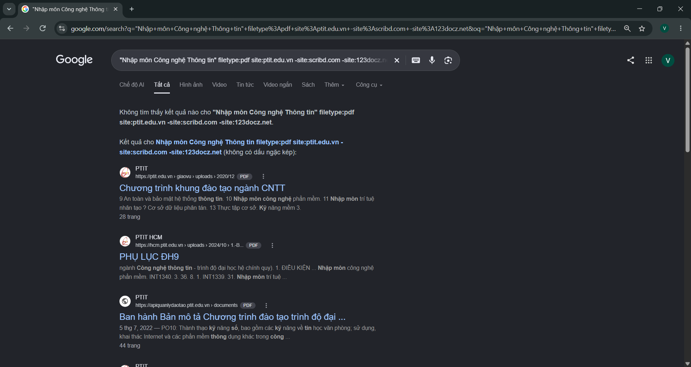

# BÀI 1: TÌM KIẾM TÀI LIỆU HỌC TẬP CHÍNH THỐNG BẰNG GOOGLE

#### ***Sinh viên: Võ Xuân Thịnh – Lớp CNTT2-K26***

## 1. Mục tiêu

Sử dụng phối hợp các toán tử tìm kiếm nâng cao để tìm kiếm tài liệu chính thống, tránh mã độc.

## 2. Bối cảnh (Roleplay)

Là sinh viên cần tìm giáo trình "Nhập môn Công nghệ Thông tin" bản PDF của Học viện để ôn thi, nhưng kết quả Google toàn trả về trang bắt nạp thẻ hoặc quảng cáo bài viết không liên quan.

## 3. Yêu cầu nghiệp vụ

### 3.1. Query dùng `filetype:`, `site:` và dấu ngoặc kép

```
"Nhập môn Công nghệ Thông tin" filetype:pdf site:ptit.edu.vn -site:scribd.com -site:123docz.net -site:doc.edu.vn
```


| Toán tử          | Tác dụng                                                               |
| ------------------ | ------------------------------------------------------------------------ |
| `" "`              | Chỉ lấy kết quả chứa đúng cụm từ tên giáo trình              |
| `filetype:pdf`     | Chỉ trả về file PDF, bỏ trang bài viết, blog                       |
| `site:ptit.edu.vn` | Chỉ tìm trên máy chủ của Học viện, nên là nguồn chính thống |

### 3.2. Toán tử trừ (`-`) loại ít nhất 2 trang web "rác"


| Toán tử           | Lý do loại                                      |
| ------------------- | ------------------------------------------------- |
| `-site:scribd.com`  | Đòi nạp thẻ / đăng nhập mới cho tải      |
| `-site:123docz.net` | Quảng cáo, tài liệu không rõ nguồn         |
| `-site:doc.edu.vn`  | Tổng hợp tài liệu, bắt tải kèm quảng cáo |

## 4. Yêu cầu đầu ra

### 4.1. Vì sao `filetype:` tiết kiệm thời gian hơn gõ "tải sách…"?

- Gõ "tải sách…": Google trả về đủ thứ như blog, quảng cáo, trang bắt nạp thẻ. Mình phải mở từng trang, đọc rồi mới biết có file hay không, dễ bị chuyển hướng hoặc tải nhầm file lạ.
- Dùng filetype:pdf: Google chỉ trả về file PDF, nên bước "mở từng trang để kiểm tra" biến mất. Bấm vào kết quả là ra thẳng tài liệu.
- Kết hợp site: của trường và dấu trừ (-): danh sách rút gọn còn vài kết quả đúng nguồn, ít nguy cơ mã độc.

### 4.2. Ảnh chụp 3 kết quả đầu tiên sau khi áp dụng "Combo toán tử"


